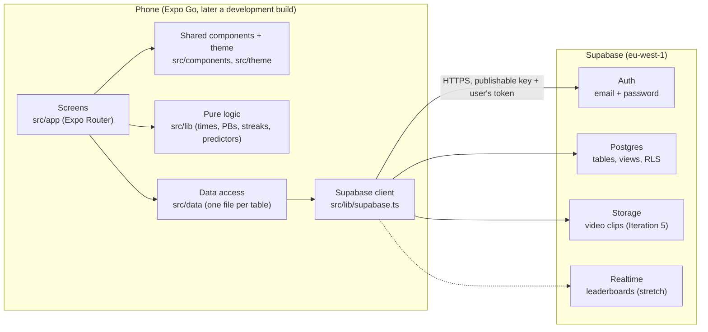

# Architecture

Sprinter is a mobile app without its own server. The app talks directly to Supabase, and row level security in the database controls what each user can read and write.

## Overview

## The layers

| Layer | Folder | What it does | Rule |
| --- | --- | --- | --- |
| Screens | `src/app/` | One file per screen, and the folder layout sets the navigation (Expo Router) | Screens never call Supabase directly, they go through `src/data` |
| Components and theme | `src/components/`, `src/theme/` | Panel, Label, Wordmark, TopBar, PaperBackground, Button, TextField, Chip and FormScreen so far (more as screens need them); tokens for colours, fonts and spacing | No hard coded colours or fonts outside `theme` |
| App state | `src/context/` | `AuthProvider` holds who's signed in and their profile for every screen | Goes through `src/data`, never calls Supabase directly |
| Logic | `src/lib/` | Plain TypeScript for formatting and parsing times, PBs, streaks and predictors | No React or Supabase in here, so it can all be unit tested on its own |
| Data access | `src/data/` | Functions like `getSessions()` and `saveSession()` that wrap the Supabase queries and return typed objects | The only place that knows table and column names |
| Database | `supabase/migrations/` | Tables, views and RLS policies | Every change gets a new migration file |

I've kept logic and data access out of the screens for two reasons. Most of the code can be tested without a phone, and if a table changes, only one file in `src/data` has to change with it.

## Key flows

**Sign up.** The app calls `supabase.auth.signUp` with the email, password and display name. Supabase Auth creates the user and a database trigger creates their `profiles` row. The session token is saved on the phone with AsyncStorage so they stay logged in. The events step then saves their username, events and age group to that row. It comes after the account exists because signed out users can't read `profiles`, so a taken username can only be caught at that point.

**Which screens someone can reach.** `AuthProvider` listens with `onAuthStateChange`, loads the profile and works out a status: signed out, needs the events step, or ready. `Stack.Protected` in the root and `(auth)` layouts only includes the screens for that status, and Expo Router moves people on when it changes. This only decides what the app shows. RLS is still what protects the data.

**Log a session (use case 1).** The Log screen holds the session and its reps in memory until the user saves. `src/data/sessions.ts` then inserts the session, followed by the reps, and RLS checks that the user id on every row belongs to the signed in user. After that the app reloads `personal_bests` and highlights any distance where the new rep is now the best.

**Squad data (Iteration 6).** This works the same way, except the RLS policies on `sessions` and `reps` also let members of a shared squad read each other's rows. The app code shouldn't change much because the database does the filtering.

## Security

- The publishable key in `.env` is safe to ship in the app. All it does is identify the project, and RLS blocks anything the signed in user isn't allowed to touch.
- The service role key is never used in the app and never committed.
- `.env` is git ignored, and `.env.example` lists the variables without any values.

## Environments and builds

| Stage | How it runs | Why |
| --- | --- | --- |
| Iterations 3 to 7 | Expo Go on my phone, `npx expo start` (Expo SDK 58) | No native build needed, since every library so far works in Expo Go. Fonts load at runtime with `@expo-google-fonts` for the same reason |
| Iteration 8 (only if wearables) | EAS development build | Apple Health and Health Connect need native code that Expo Go doesn't include |

I use one Supabase project (`sprinter-fyp`) for development. Test accounts are made by hand for now, and seeded demo data comes in Iteration 4.

## Alternatives considered

This is the short version. The full reasoning is in the logbook decisions (D2, D3).

| Choice | Picked | Rejected and why |
| --- | --- | --- |
| App framework | Expo (React Native) | Flutter (a new language to learn), native Swift/Kotlin (two codebases) |
| Backend | Supabase | Firebase (NoSQL makes leaderboard and PB queries harder), own Node server (more to build and host) |
| Navigation | Expo Router | React Navigation on its own (more setup, and Expo Router is built on it anyway) |
