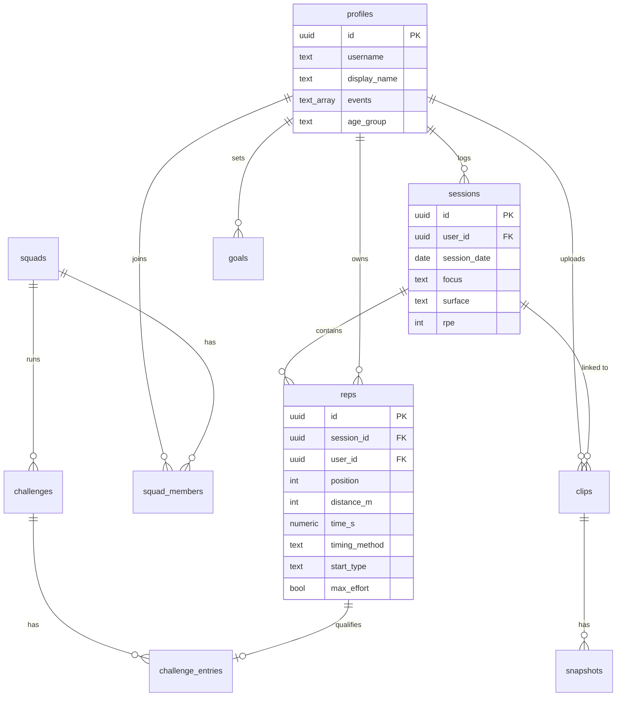

# Data model

This page covers how Sprinter stores its data in Supabase (Postgres) and who gets to see what.

Status: the Iteration 3 tables are written up in full. Later tables are only sketched for now, and I'll fill them in during the iteration that builds them. If this page and `supabase/migrations/` ever disagree, the migrations are right.

## Design choices

- **One row per rep, not one JSON blob per session.** PBs, leaderboards and squad comparisons all come down to querying reps, like the fastest time per distance for a given timing method. That's much easier when each rep is its own row with typed columns.
- **RLS is on for every table.** The publishable key ships inside the app, so the app can't be what enforces access. The database decides who can read and write each row.
- **Hand and electronic times stay separate and are never converted.** Each rep records how it was timed, and PBs and leaderboards are worked out per timing method. A hand time never gets ranked against an electronic one.
- **Only max effort reps from a standing, crouch or blocks start count for PBs.** You can still log drills, tempo reps and flying or rolling starts, but they don't set PBs, because a flying 30m is far quicker than a 30m from blocks (US3, R6).
- **Times are stored in seconds to the hundredth**, like 11.84, because that's how they're read off a stopwatch. `numeric(6,2)` is an exact decimal type, so there are no rounding errors.
- **Every schema change is a migration file** in `supabase/migrations/`, committed along with the code that needs it.

## Entity relationship diagram

## Iteration 3 tables (detailed)

### profiles

Each user has one row here. A trigger on `auth.users` creates it when they sign up.

| Column | Type | Rules | Why |
| --- | --- | --- | --- |
| id | uuid | PK, references `auth.users(id)`, delete cascade | Matches the login id, so deleting the account deletes the profile too |
| username | text | unique, 3 to 20 chars, lowercase letters, numbers, `_` | For finding friends and squad mates later on |
| display_name | text | not null | The name people see on feeds and leaderboards |
| events | text[] | default `{}` | The events an athlete trains for, e.g. `{60m,100m,200m}` (US1) |
| age_group | text | one of `U16`, `U18`, `U20`, `Senior`, `Masters` | Keeps comparisons fair (US1, C4) |
| club | text | optional | |
| created_at | timestamptz | default `now()` | |

Sex is not stored for now. Whether leaderboards need a sex filter gets decided in Iteration 6 when they're built (decided 4 Nov), which keeps personal data to a minimum until then.

### sessions

A single training session on a single day.

| Column | Type | Rules | Why |
| --- | --- | --- | --- |
| id | uuid | PK, default `gen_random_uuid()` | |
| user_id | uuid | not null, references `profiles(id)`, delete cascade | Who owns the session |
| session_date | date | not null, default today | |
| focus | text | one of `acceleration`, `max_velocity`, `speed_endurance`, `race`, `other` | For filters later, and recommendations in C2 |
| surface | text | one of `track`, `indoor`, `grass`, `turf`, `road` | |
| rpe | smallint | 1 to 10, optional | How hard the session felt |
| notes | text | optional | |
| created_at, updated_at | timestamptz | default `now()` | A trigger sets `updated_at` on update |

### reps

A single timed run in a session.

| Column | Type | Rules | Why |
| --- | --- | --- | --- |
| id | uuid | PK | |
| session_id | uuid | not null, references `sessions(id)`, delete cascade | Delete a session and its reps go with it |
| user_id | uuid | not null, references `profiles(id)` | Copied from the session so RLS and filtering by user can skip the join |
| position | smallint | not null, 1 upwards | Where the rep falls in the session |
| distance_m | smallint | 10 to 600 | Keeps it to sprint distances |
| time_s | numeric(6,2) | greater than 0 | Stored to the hundredth of a second |
| timing_method | text | `hand` or `electronic`, default `hand` | Most club times are hand timed (US2, US7) |
| start_type | text | `blocks`, `crouch`, `standing`, `flying`, `rolling` | The start makes a big difference to a time, especially on short reps |
| max_effort | boolean | default true | Only max effort reps count for PBs (US3) |
| note | text | optional | |
| created_at | timestamptz | default `now()` | |

There's also a composite foreign key, `(session_id, user_id)` referencing `sessions (id, user_id)`. It makes sure `reps.user_id` matches whoever owns the session, so nobody can add a rep to someone else's session.

### personal_bests (view)

This gives the fastest max effort rep for each user, distance and timing method, counting only blocks, crouch and standing starts. It's built with `security_invoker = true`, so it follows the same RLS as `reps` and can't leak anyone else's times.

| Column | Meaning |
| --- | --- |
| user_id | |
| distance_m | |
| timing_method | |
| best_time_s | The fastest time |
| rep_id, session_date | The rep that set it, so the app can link back to the session |

## Who can see what (RLS)

In Iteration 3 you can only see your own data. Squad access doesn't arrive until Iteration 6, but I've put it in the table below so the plan is clear. Coaches can view their athletes' sessions and reps but can't edit them, so an athlete's times always stay their own (decided 4 Nov).

| Table | Select | Insert | Update | Delete |
| --- | --- | --- | --- | --- |
| profiles | Any signed in user (needed to find people) | Trigger only | Own row | Via account deletion |
| sessions | Own rows. Iteration 6: squad mates and coaches | Own rows | Own rows only (coaches can't edit) | Own rows only |
| reps | Own rows. Iteration 6: squad mates and coaches | Own rows, in own session | Own rows only (coaches can't edit) | Own rows only |
| personal_bests | Follows reps | n/a | n/a | n/a |

How I'll know this is done: using two test accounts, account B should get zero rows back when selecting account A's sessions and reps, and trying to insert a rep into A's session should fail.

## Later tables (sketch)

| Table | Iteration | Key columns | Requirement |
| --- | --- | --- | --- |
| goals | 4 | user_id, distance_m, timing_method, target_s, set_by (`user` or `adaptive`) | S1, C1 |
| clips | 5 | user_id, session_id (optional), rep_id (optional), storage_path, duration_s, poster_path, shared_with_squad | M9 |
| snapshots | 5 | clip_id, user_id, time_s, image_path, lines (jsonb), note | M9 |
| squads | 6 | name, invite_code (6 chars, unique), created_by | M5 |
| squad_members | 6 | squad_id, user_id, role (`coach` or `athlete`), joined_at | M5, M8 |
| challenges | 7 | squad_id, title, distance_m, timing_method, starts_at, ends_at | S2 |
| challenge_entries | 7 | challenge_id, user_id, rep_id, time_s | S2 |
| badges, user_badges | 7 | code, name; user_id, badge_id, earned_at | S3 |
| reactions, comments | 7 | target (session or PB), user_id, body | S4 |
| friendships | 8 (stretch) | requester_id, addressee_id, status | C4 |

The squad feed (M6) and squad leaderboard (M7) don't need tables of their own. They're views over `sessions`, `reps` and `personal_bests`, filtered by squad membership.

## Removed

- `test_messages` was the test table from the Supabase setup (#9). The first real migration drops it.
